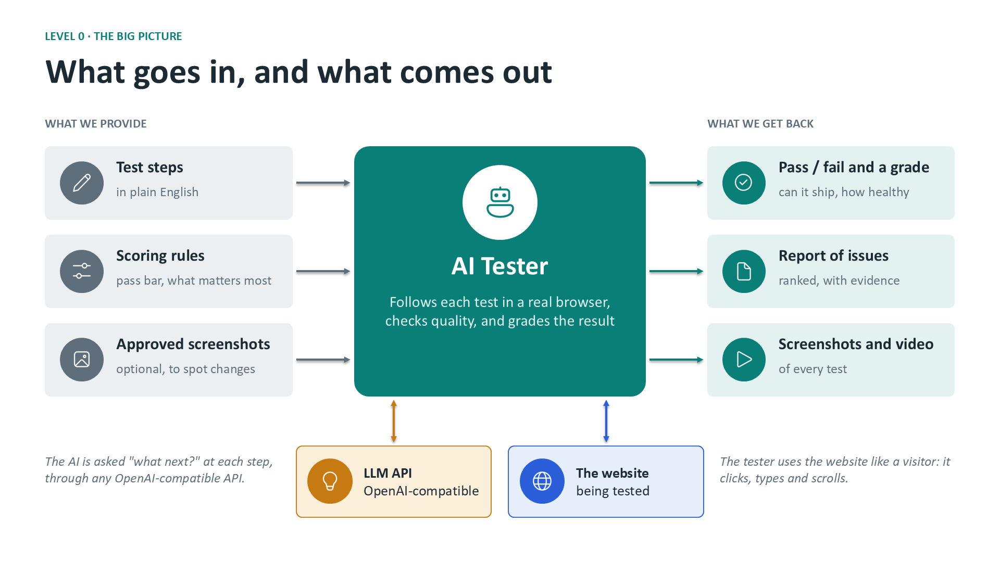
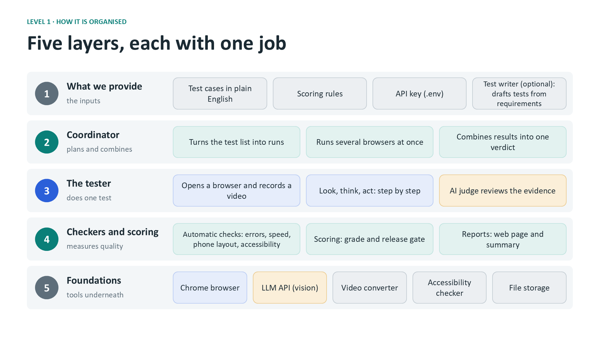
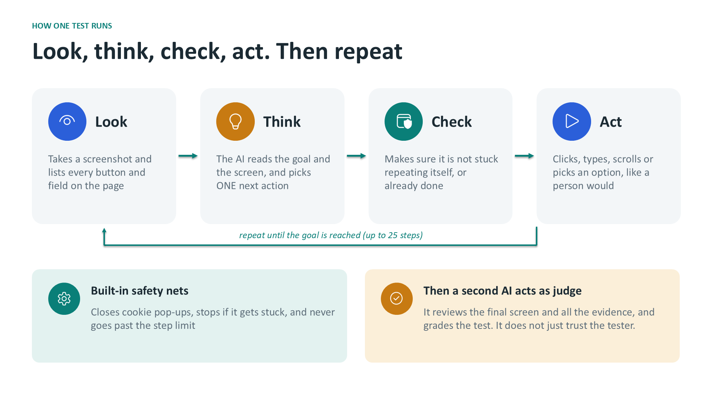
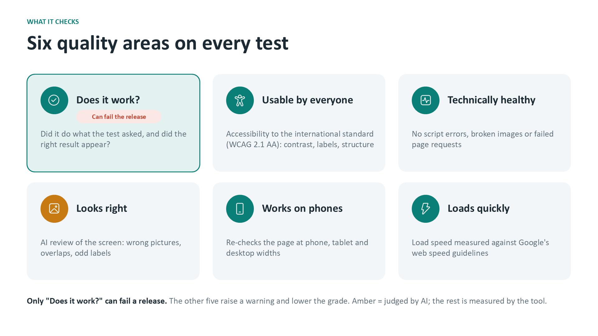
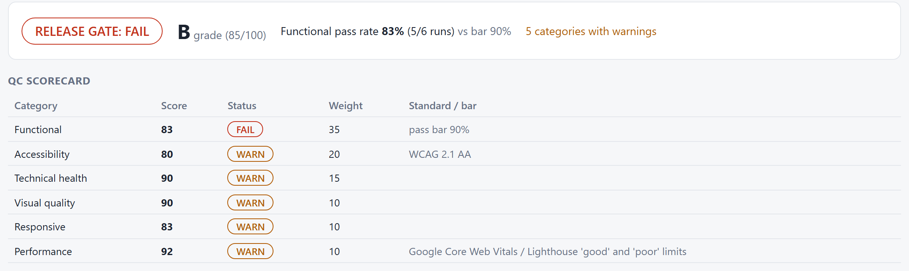

# CUA QA Agent

**An AI tester that checks websites the way a QA engineer does.**

You describe a test in plain English, for example *"Log in and buy a backpack. The order should be confirmed."* The agent opens a real browser, looks at the screen, clicks, types and scrolls until the job is done, then hands back a **graded QA report** with screenshots and a **video** of the whole session.

It is a *computer-using agent* (CUA): a vision LLM decides each next action from a screenshot, and [Playwright](https://playwright.dev/python/) carries it out in Chromium. It works with any OpenAI-compatible API whose model accepts images.

---

## See it in action

Both clips are real recordings made by the agent, shown here at 2× speed. The caption bar shows what the AI decided at each step, and the red circle marks where it clicks.

### Example 1: buying an item on a demo shop (PASS)

Goal: *log in, add a product to the cart and complete the checkout.* The agent works out every click by itself and passes with **grade A (98/100)**.

[](docs/videos/demo_shop_checkout.mp4)

[▶ Full-length video (43 s, MP4)](docs/videos/demo_shop_checkout.mp4)

### Example 2: catching a real problem on a live site (FAIL)

Goal: *search a university lab website for the word "diffusion".* The agent checks the header, scrolls the page and finds no usable search box, so it fails the test and explains why. A search field does exist in the page code, but it is invisible on a desktop screen. Result: **FAIL, grade D (61/100)**.

[](docs/videos/uaim_search.mp4)

[▶ Full-length video (34 s, MP4)](docs/videos/uaim_search.mp4)

---

## How it works

### The big picture



You provide **test steps**, **scoring rules** and, optionally, **approved screenshots** to compare against. The agent talks to two things: an **LLM API**, which decides each next action, and the **website** under test, which it uses like a visitor. You get back a **pass/fail with a grade**, a **ranked list of issues**, and **screenshots plus a video** of every test.

### Five layers, each with one job



| Layer | What it does | Code |
|---|---|---|
| 1. What we provide | Test cases, scoring rules, API key, optional test writer | `tests/`, `metrics.json`, `.env`, `generate_tests.py` |
| 2. Coordinator | Turns the test list into runs, runs several browsers at once, combines the results | `agent.py` (`main`, `finalize`) |
| 3. The tester | Opens a browser, runs the look-think-act loop, then an AI judge grades the result | `agent.py` (`run_case`) |
| 4. Checkers and scoring | Automatic checks, the scorecard and grade, the reports | `checks.py`, `metrics.py`, `report_html.py` |
| 5. Foundations | Chromium, the LLM API, ffmpeg for video, axe-core for accessibility, files on disk | `requirements.txt`, `vendor/` |

### What happens in one test



1. **Look:** take a screenshot and number every button, link and field on the page.
2. **Think:** send the goal, the screenshot and the numbered list to the LLM, which replies with **one** action as JSON (click, type, select, press, scroll, go to URL, or done).
3. **Check:** a guard catches invalid replies and stops the agent if it repeats the same action on an unchanged page.
4. **Act:** Playwright performs the action. Repeat, up to 25 steps.

When the loop ends, a **second LLM call acts as judge**. It reviews the final screenshot, the step log and the automatic findings, and grades the run. It does not simply trust what the tester claims.

---

## What it checks



| Area | How it is measured | Can it fail the run? |
|---|---|---|
| **Functional** | Judge: was the task done and is the expected result on screen? | **Yes** |
| **Accessibility** | [axe-core](https://github.com/dequelabs/axe-core) against WCAG 2.1 A and AA | Warns |
| **Technical health** | JavaScript errors, failed requests, broken images | Warns |
| **Visual quality** | Judge: wrong images, overlaps, odd labels | Warns |
| **Responsive** | Horizontal overflow at 375, 768 and 1280 px widths | Warns |
| **Performance** | First Contentful Paint, Largest Contentful Paint, load time, layout shift (Core Web Vitals limits) | Warns |

Every run ends with two separate answers:

- **Release gate (PASS/FAIL):** *can it ship?* PASS when at least **90%** of runs pass functionally.
- **Grade (A to F):** *how healthy is it?* A weighted score across all six areas.

All weights and thresholds live in [`metrics.json`](metrics.json), so you can tune them without touching code.



---

## Quick start

**Requirements:** Python 3.10 or newer, and an OpenAI-compatible API key for a model that accepts images.

```bash
# 1. Install
pip install -r requirements.txt
python -m playwright install chromium

# 2. Configure: copy the example and fill in your own key and endpoint
cp .env.example .env            # on Windows: copy .env.example .env

# 3. Run a test suite
python agent.py tests/saucedemo.json
```

Then open `results/<run>/report.html` in your browser.

> **Keep your key private.** `.env` is in `.gitignore` and must never be committed. Only `.env.example`, which holds placeholders, is shared.

### Useful options

```bash
python agent.py tests/advanced.json --runs 3            # repeat each test 3 times and report a pass rate
python agent.py tests/advanced.json --workers 3         # run 3 browsers in parallel
python agent.py tests/advanced.json --fast              # faster: no model reasoning on click steps
python agent.py tests/advanced.json --headed            # watch the browser live
python agent.py tests/advanced.json --baseline save     # store approved screenshots
python agent.py tests/advanced.json --baseline compare  # later: flag visual changes and regressions
python agent.py tests/advanced.json --no-video          # skip the session recording
```

| Command | What it does |
|---|---|
| `python generate_tests.py requirements/saucedemo_requirements.md --url https://www.saucedemo.com/` | Drafts test cases from a plain-English requirements file (review them before use) |
| `python rescore.py results/<run>` | Re-grades a finished run with the current `metrics.json`, with no browser and no LLM calls |

---

## Writing a test

A test suite is a JSON list. Each test needs a name, a start URL, a goal and an expected result:

```json
[
  {
    "name": "Add to cart and verify",
    "url": "https://www.saucedemo.com/",
    "goal": "Log in as 'standard_user' / 'secret_sauce', add the 'Sauce Labs Backpack' to the cart, then open the cart.",
    "expected": "The cart page lists exactly one item, 'Sauce Labs Backpack'."
  }
]
```

You can add `"ignore": ["analytics.example.com"]` to skip known third-party noise in the technical checks.

Example suites are in [`tests/`](tests/). They target [SauceDemo](https://www.saucedemo.com/), a public demo shop made for testing tools, plus one read-only suite for a public website. Only point the agent at sites you own or have permission to test.

---

## What a run produces

```
results/<time>_<flags>_<id>/
├── report.html              gate · grade · scorecard · top issues · per-run detail with videos
├── summary.md               the same summary as text
└── 01_<test name>/
    ├── report.md            readable record of this run
    ├── result.json          all raw data (lets rescore.py re-grade it later)
    ├── step01.png …         what the model saw at each step
    ├── final.png            the page at the end
    ├── responsive_*.png     phone, tablet and desktop widths
    ├── diff.png             only with --baseline compare
    └── session.mp4          the video, with captions and click markers
```

---

## Project structure

```
agent.py           entry point: the step loop, the judge, parallel runs, reports
checks.py          automatic checks (axe, broken images, overflow, speed) and baselines
metrics.py         scoring, grade and release gate      metrics.json   the scoring policy
report_html.py     the HTML report
generate_tests.py  drafts tests from a requirements file
rescore.py         re-grades a saved run
tests/             example test suites
requirements/      example requirements file
vendor/            a local copy of axe-core
docs/              README figures and example videos
```

---

## Good to know

- **Results can vary between runs.** LLMs are not fully consistent, so use `--runs 3` and read the pass rate.
- **Functional and visual scores are AI judgements.** The other four areas are measured by code.
- **`--fast` relies on `chat_template_kwargs.enable_thinking`**, which Qwen-style servers (vLLM, LiteLLM) understand. Other providers may ignore it.
- **Screenshots of the tested pages are sent to your LLM endpoint.** Use test accounts and test data.
- **Not handled yet:** two-factor logins, CAPTCHAs, file uploads, iframes and multi-tab flows.
- **Performance numbers are lab measurements** from your machine. Use `--workers 1` for stable timings.

## Credits

- [Playwright](https://playwright.dev/python/) for browser automation.
- [axe-core](https://github.com/dequelabs/axe-core) by Deque Systems (MPL-2.0), included in `vendor/`.
- [SauceDemo](https://www.saucedemo.com/) by Sauce Labs, the demo shop used in the examples.
- Video conversion uses the ffmpeg build bundled with [imageio-ffmpeg](https://github.com/imageio/imageio-ffmpeg).
